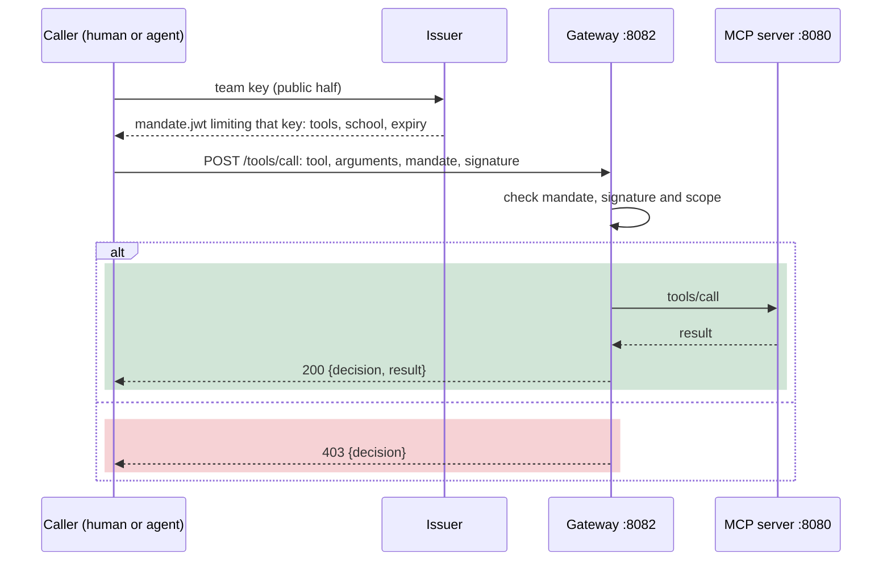

# Mandate Gateway Hackathon

The local school administrator has full access to all local schools' pupil data: census records, names,
care status, everything. They are not technical, and are stretched thin for capacity. They have started handing jobs to AI agents: find a pupil's
record, draft the absence letters, count the pupils in care.

Today the only access they can give an agent is their own, which is all of it. What they want is to pass down just
the part each job needs, for as long as the job lasts, and to be able to take it back. They will ask for this in
plain words, every request will sound reasonable, and the requests get harder as the hackathon goes on.

**The open question for these two days: how should a person pass part of their access down to an agent?**

## The Problem

Agents increasingly use the same servers people do, and they usually get in the same way: with a bearer token:

- It says who, not what for, how far or until when.
- Any leak (a log line, a prompt, a tool argument) hands over everything it allows.
- It cannot be passed to a helper agent without passing on all of it.

## An (Initial) Solution

- A [**mandate**](https://agentmandate.net/) is a signed grant from a person to one agent. It is
  limited to certain tools and data, it expires, and it can be revoked.
- A **gateway** sits in front of the data and checks the mandate on every call the agent makes.

Both are small and deliberately breakable/changeable. Beyond that the design is yours to address within your teams: change the mandate, change the gateway, or bring a problem
of your own. 

What we want at the end is what you found out: where agent mandates hold and where they don't.

## The path

1. **Get it running.** Follow [Start here](#start-here) below. (~30min for set-up & discussion)
2. **Build: questions 0 to 5** (Day 1 morning). Each [question](questions/README.md) starts with something the administrator asks 
   their agent to do. The starter gateway already handles questions 0 to 2 and gets 3 to 5 wrong. Done when
   `make eval_run` shows questions 0 to 5 passing. These smaller questions are a chance for you to get acquainted with your teams! (~2h)
3. **Explore: questions 6 to 16** (Day 1 afternoon). These are open problems with no specific right answer. Take on one or more, or a problem of your own. (~3h)
   Partway through there is a check-in ([AGENDA.md](AGENDA.md)): each team shows a mandate, a request it allows and
   a request it denies for the question it took, laid out like the [worked example](questions/02-worked-example.md).
4. **Deploy and harden** (Day 2 morning). Put your gateway on a URL and post it, with the default attack mandate and a
   feature mandate from your Day 1 question ([ATTACK_SCORING.md](day_2_attack/ATTACK_SCORING.md)). Add any final protection (~2h)
5. **Attack** (Day 2 afternoon). Try to get data out of other teams' gateways that their mandates do not cover.
   An attack *lands* when a request goes through the gateway and returns data outside the mandate. 
6. **Show and tell** (Day 2, 16:00). One attack that landed on you, one you landed, one thing this design gets
   right and one it gets wrong.

## Start here

1. Install Docker (with compose), [uv](https://docs.astral.sh/uv/) (`brew install uv`), Node/npm and `make`.
2. Run it:

   ```bash
   make hack        # keys, a one-school mandate, the eval pack, all containers, and an example signed call
   make eval_run    # every question's cases against your gateway, PASS/FAIL, then a tally per question
   make install     # Installs & rebuilds all containers
   make demo        # Starts all containers, the demo UI and the gateway's /demo routes included (local only)
   make run         # Starts what gets deployed: the data server and the gateway, nothing else
   ```

3. Open **[questions/README.md](questions/README.md)**. It lists the questions, 0 to 16. Each starts with something the administrator asks.
4. Read [gateway/lib/gateway_verify.py](gateway/lib/gateway_verify.py). It walks through the current verification process.

**Desk**, for school staff: `uv run --no-sync python -m desk`, then open a sign-in link it prints. Give an assistant a job
in plain words, approve what it asks, take it back, and see what it saw. **The lab**: `uv run --no-sync python -m lab`, then
`http://127.0.0.1:8184`. The gateway before and after our changes, question by question. Neither needs Docker. What each
question shows is in [docs/questions_4_to_16.md](docs/questions_4_to_16.md).

The `/demo/*` routes sign mandates for anyone who asks. The gateway image leaves them out (see
[.dockerignore](.dockerignore)), and a checkout serves them only with `GATEWAY_DEMO=1`. `make hack` and `make demo` add
[docker-compose.demo.yaml](docker-compose.demo.yaml), which mounts them back in, switches them on and starts the demo UI.
`make run` and plain `docker compose` start what gets deployed, without them
([ADR-0001](adr/0001-gateway-image-is-the-security-boundary.md)).

Ports: MCP server `:8080` (inside Docker only, it has no access control), gateway `:8082`, demo UI `localhost:8081/demo` with `make hack` or `make demo` (a walkthrough of issuing a mandate and making a call - feel free to extend, e.g - for human in the loop escalation.).
`make test` and `make lint` run the tests and ruff. The data sources are listed in
[mcp_server/data/synthetic/synthetic_manifest.json](mcp_server/data/synthetic/synthetic_manifest.json).

## Current flow architecture

| Key | Who holds it | What it does |
| --- | --- | --- |
| **Issuer key** (`gateway/state/issuer_key.pem`) | The person granting access. Locally, `make hack` makes one, so each team is its own issuer | Signs mandates. The gateway only trusts mandates from issuers in `trusted_list.json` |
| **Team key** (`gateway/state/agent.pem`) | The caller (a team, a person or an agent). Make a new one any time with `cli keygen` | Signs each request. It only works with a mandate issued for it |
| **Gateway audit key** (`gateway/state/runtime/secrets/gateway_key.pem`) | Only the gateway runtime | Signs the tamper-evident decision record; it is injected at runtime and is not copied into the image |

The issuer signs a grant for one team key that limits it to certain tools, a school
and a time window. Unlike a bearer token, a stolen mandate is useless without the team key, and the team key can
do nothing without a mandate. For the attack phase, you issue a mandate with *your* issuer key for *another team's*
public team key, and it only works against your gateway.



Where each step lives in the code:

| Step | Code |
| --- | --- |
| Team key | `gateway/state/agent.pem`, made by `cli keygen` / `load_or_create_key` in [gateway/cli.py](gateway/cli.py) |
| Issuer signs the mandate | `cli issue` → `issue_mandate` in [gateway/cli.py](gateway/cli.py), `MandateIssuer` in [gateway/lib/mandate_issuer.py](gateway/lib/mandate_issuer.py). Issuer key: `gateway/state/issuer_key.pem` |
| Caller signs the request | `sign_request` in [gateway/cli.py](gateway/cli.py); the proof binds the mandate audience, `POST`, `/tools/call`, tool, arguments, mandate hash, nonce and time |
| Gateway endpoint | `tools_call` in [gateway/main.py](gateway/main.py) |
| Mandate, signature and scope checks | [gateway/lib/gateway_verify.py](gateway/lib/gateway_verify.py), trusted issuers [gateway/lib/trust_registry.py](gateway/lib/trust_registry.py), revocation [gateway/lib/status_list.py](gateway/lib/status_list.py) |
| MCP server | [mcp_server/api/routes_mcp.py](mcp_server/api/routes_mcp.py) |


## The MCP server's tools

The gateway sees each tool as `pupil-data.<tool>`. 

| Tool | Returns | Useful for |
| --- | --- | --- |
| `search(query, urn, limit)` | Census rows matching a substring | Questions 0 to 5 |
| `get(path, limit)` | One data file, parsed | Question 4 |
| `aggregate(table, group_by, measure, where)` | Counts per group, unsuppressed | Question 8 |
| `classification()` | PII level of every table and column | Questions 6 and 15 |
| `roster(urn, year_group, academic_year, term)` | Pseudo IDs and names of a Year 10 or 11 at one school | Questions 7 and 11 |
| `pupil(pupil_id, urn)` | One pupil's full record: census (ethnicity, care status), name, deprivation | Questions 6, 11, 12 and 15 |
| `draft(urn, pupil_ids, kind)` | A letter home per pupil, by name. Matches `*.draft`, so `STEP_UP` | Questions 7, 10 and 12 |
| `write(pupil_id, urn, column, value, reason)` | Corrects one census field, appended to `mcp_server/data/writes/corrections.jsonl`. Matches `*.write`, so `STEP_UP` | Questions 9 and 14 |

## What the gateway checks

`make eval_run` sends the cases in [gateway/eval.py](gateway/eval.py) using this mandate:

| Field | Value | Meaning |
| --- | --- | --- |
| `scope` | `search` with `urn` ∈ [`SCH01`] | Search pupils of one school only |
| `scope` | `get` with `path` ∈ [`synthetic/synthetic_schools.csv`, `synthetic/synthetic_manifest.json`] | Read only the two files with no pupil data, by exact path |
| `deny` | `*.write`, `pii.*` | Refused before scope is checked |
| `exp` | 3 days from issue (`--ttl`) | The `expired` case uses a copy that expired 2 minutes ago |
| `cnf.jwk` | public key of `eval_pack/agent.pem` | Only that key can sign requests |
| `vct` / `aud` | hardened mandate v2 / this gateway's unique audience | Selects the fail-closed validation profile and prevents use at another gateway audience |
| `purpose_code` / `clearance` / `budget` | explicit signed values | No missing-claim compatibility defaults are applied by the gateway |
| `principal_epoch` | current epoch from signed people policy | Any authority-bearing change makes old mandates permanently invalid |
| `principal` / `org` / `purpose` | `eval:runner` / `org:hackathon` / `eval set` | Who it was issued to and why |

Question 5 also uses `eval_pack/two_schools.jwt`, the same mandate with `search` scoped to `SCH01` and `SCH02` as
two separate entries.

The starter gateway checks a request in this order
([gateway/lib/gateway_verify.py](gateway/lib/gateway_verify.py)):

1. The mandate: does it match the complete v2 profile and gateway audience, is the issuer trusted, is the signature
   valid, is it in date, and is it revoked by the newest accepted status-list sequence?
2. The request: is its destination-bound proof signed by the mandate's key, is it fresh (within 5 minutes), has the
   nonce been seen before, and is the caller inside the durable rate windows?
3. The scope: is the tool on a deny rule, is it in scope, and does every constrained argument have an allowed
   value?
4. The signed people policy: is the delegator active, still authorized for the school and clearance, and still on the
   exact authorization epoch recorded in the mandate?

Since questions 3 to 5 were fixed, step 3 also asks how much: a `search` needs a non-blank `query`, and a `limit` on
`search` or `get` (100 when left out) must be a whole number from 1 to 100, and no higher than the scope entry's
`max_rows` when it sets one. A `path` is cleaned before it is compared and forwarded (`./a` and `a//b` mean `a`);
one with `..`, a leading `/` or anything a server could read as another file is refused. A mandate with several
entries for one tool allows the call if any one entry accepts all of it.

Each answer is `200 ALLOW`, `202 STEP_UP` (held for approval, not forwarded) or `403 DENY`, with a `reason_code`:

| `reason_code` | Meaning |
| --- | --- |
| `IN_SCOPE` | Allowed |
| `SENSITIVE_TOOL` | Step-up: the tool matches `*.write` or `*.draft` |
| `SIG_INVALID` | The mandate's issuer signature does not match its payload, e.g. after editing it |
| `EXPIRED` / `REVOKED` | Out of date, or its index is set in the status list |
| `WRONG_TOKEN_TYPE` / `ISSUER_NOT_ACCREDITED` / `WRONG_AUDIENCE` / `NOT_YET_VALID` / `STATUS_UNAVAILABLE` | Not a mandate, an untrusted issuer, another gateway's mandate, `nbf` in the future, or no authentic current status list |
| `POP_FAILED` | The request was not freshly signed by the mandate's key, predates this gateway process, or reuses a nonce |
| `RATE_LIMITED` | A durable per-agent/tool, per-mandate or per-principal request window is full |
| `BACKEND_TIMEOUT` / `BACKEND_RESPONSE_TOO_LARGE` / `BACKEND_UNAVAILABLE` | The data service exceeded its time or response bound, or refused the call |
| `DENIED_BY_RULE` | The tool matches a `deny` glob. Checked before scope |
| `OUT_OF_SCOPE` | No scope entry lists the tool |
| `CONSTRAINT_MISSING` / `CONSTRAINT_VIOLATED` | A constrained argument is absent, or its value is not in the allowed list |
| `LIMIT_NOT_ALLOWED` | `limit` on `search` or `get` is not a whole number from 1 to 100 |
| `LIMIT_EXCEEDED` | `limit` (or the 100 a call gets when it leaves `limit` out) is above the scope entry's `max_rows` |
| `QUERY_TOO_BROAD` | A `search` that is blank, or that matches 90% or more of the records in its scope |
| `MALFORMED_REQUEST` | The checks could not make sense of the request, so it is refused |
| `PATH_NOT_ALLOWED` | A `path` written in a way that a server could read as another file |
| `POLICY_UNAVAILABLE` | The signed people policy is missing, forged, stale, torn or rolled back |
| `PERSON_UNKNOWN` / `PERSON_PAUSED` / `PERSON_LOST_ACCESS` / `PERSON_AUTHORITY_CHANGED` | The delegator is unknown, inactive, outside the school, or has changed authority since issue |
| `PURPOSE_MISMATCH` / `CLEARANCE_TOO_LOW` | Not what `purpose_code` covers, or too sensitive for the mandate, its purpose or its person |
| `UNSAFE_GROUPING` / `BUDGET_EXCEEDED` | A count that could single someone out, or more different pupils than the job or the person's day allows |
| `CHILD_WIDER` / `CHILD_SIG_INVALID` / `DELEGATION_NOT_ALLOWED` | A helper's mandate is wider than its parent, not made by it, or was not allowed |
| `TOO_MANY_WAITING` / `LABELS_UNAVAILABLE` / `RECORD_UNAVAILABLE` / `CLAIM_NOT_UNDERSTOOD` | Too many calls held, or something a decision needs is missing: refused |

One `search` or `get` releases 10 different pupils at most. The reply's `volume` says how many, and whether the answer
was cut short (`trimmed`). The limits are constants in [gateway/lib/volume.py](gateway/lib/volume.py).

`gateway/state/people.json` is the issuer's working copy. `cli person` signs each change into monotonic `people.jwt`;
the gateway reads only that token and rejects rollback. Authority-bearing changes increment `authz_epoch`, so old
mandates do not revive when someone returns. Every call is written before release to the runtime `record.jsonl` with
free-text queries hashed and an `fsync`; `cli log-anchor` prints its latest hash for somebody else to keep, and `cli
log-check` checks it.

CLI changes also publish the narrow runtime view under `gateway/state/runtime/`: public and signed controls in
`config/`, only the gateway's audit key in `secrets/`, and no issuer, agent or person key. Compose mounts those read
only and keeps `gateway.db` and `record.jsonl` in the separate writable `runtime/data/` mount. For state made by an
older checkout,
run `cli sign-people`, issue a fresh mandate (which republishes the sequenced status list), then `cli publish-runtime`.
The data service is also read-only apart from its dedicated `backend-writes` volume for approved corrections; the
synthetic source files remain immutable in the container.


### Changing a mandate

A mandate can't be edited: changing the payload breaks the issuer signature.
To change one, issue a new mandate for the same key and revoke the old one. For example, to move the team key from `SCH01` to `SCH02`, with
`search` only, for 1 hour:

```bash
# 1. Issue the new mandate. Note the status idx it prints, which you need to revoke this mandate later
uv run python -m gateway.cli issue --agent-key gateway/state/agent.pem --ttl 3600 -o gateway/state/sch02.jwt \
  --scope '[{"server": "pupil-data", "tools": ["search"], "constraints": {"urn": ["SCH02"]}}]' \
  --purpose "Pupil-data lookups for school SCH02" --org school:SCH02
# wrote mandate (status idx 3) to gateway/state/sch02.jwt

# 2. Use it: same key, new mandate
uv run python -m gateway.cli call --mandate gateway/state/sch02.jwt --agent-key gateway/state/agent.pem \
  --tool search --args '{"query": "P0004", "urn": "SCH02", "limit": 1}'   # 200 ALLOW

# 3. Revoke the old one. Its idx was printed when it was issued, or read it from the mandate (status.status_list.idx):
uv run python -m gateway.cli decode gateway/state/mandate.jwt
uv run python -m gateway.cli revoke --idx <that idx>
uv run python -m gateway.cli call --mandate gateway/state/mandate.jwt --agent-key gateway/state/agent.pem \
  --tool search --args '{"query": "P0004", "urn": "SCH01", "limit": 1}'   # 403 REVOKED
```

The gateway reads the status list on every request, so a revocation applies without a restart. The same steps from Python are in
[examples/sending_requests.ipynb](examples/sending_requests.ipynb).

To make a mandate say something new, such as a clearance or a limit, see [docs/new_mandate.md](docs/new_mandate.md):
`cli issue --claims` signs a claim of your own into the mandate, and the page shows where the gateway reads it.

## Sending requests

Locally, `make hack` creates a key (`gateway/state/agent.pem`) and a starting mandate for it
(`gateway/state/mandate.jwt`): `search` at school `SCH01`, and `get` on the schools file and the manifest, 2 hours. On `EXPIRED`, run
`make gateway_issue`.

To limit the key further, issue a narrower mandate, e.g. `search` only for 10 minutes:

```bash
uv run python -m gateway.cli issue --agent-key gateway/state/agent.pem --ttl 600 -o narrow.jwt \
  --scope '[{"server": "pupil-data", "tools": ["search"], "constraints": {"urn": ["SCH01"]}}]'
```

### Across laptops

Each laptop that runs `make hack` is its own issuer. To use a teammate's gateway, send them a public key and get a
mandate back. Never copy `issuer_key.pem`.

```bash
uv run python -m gateway.cli keygen -o key.pem > public_key.jwk               # you: send public_key.jwk
uv run python -m gateway.cli issue --agent-key public_key.jwk -o mandate.jwt  # them: send mandate.jwt back
```

Then call as below with `--mandate mandate.jwt --agent-key key.pem --url <their gateway>`.

### As a human

```bash
uv run python -m gateway.cli call --mandate gateway/state/mandate.jwt --agent-key gateway/state/agent.pem \
  --tool search --args '{"query": "P0004", "urn": "SCH01", "limit": 1}'
```

Response:

```text
{
  "decision": {"decision": "ALLOW", "reason_code": "IN_SCOPE", "agent_id": "ZXF9...", "detail": ""},
  "result": [{"Psuedo ID": "P0004", "AcademicYear": "2020/21", "URN": "SCH01"}]
}
```

### As an agent

[examples/sending_requests.ipynb](examples/sending_requests.ipynb) walks through it from code: an allowed call, a denied
one, then a narrower mandate issued, used and revoked. Open it in VS Code, or run
`uv run --with jupyter jupyter lab examples/sending_requests.ipynb`. The same `call` as a plain script is
[examples/agent_request_example.py](examples/agent_request_example.py).

For a model-driven agent, give the model `call` as its tool. The agent loop is yours to write.

`GET localhost:8082/describe` lists the tools and the signing rules, with a worked example.

## Day 2 deployment checklist

1. Start from fresh issuer state for the public deployment; do not reuse state that was ever exposed with demo mode.
2. Run `make eval_build`, then issue the default and feature mandates with `make attack_mandates`. These commands
   refresh the sequenced status list, signed people policy and `gateway/state/runtime/` publication.
3. Keep `gateway/state/issuer_key.pem`, agent keys, person keys and the parent state directory on the issuing laptop.
   The gateway receives only `runtime/config`, `runtime/secrets/gateway_key.pem` and its writable data volume. Never
   publish or commit the issuer state.
4. Expose only the gateway. Port 8080 is the unauthenticated data server and must remain private.
5. Deploy one gateway replica with persistent runtime data. Multiple replicas are safe only when they share the same
   SQLite store; separate databases split replay, version, rate, helper-slot, hold and budget state.
6. Before posting the URL, run `GATEWAY_URL=https://… make preflight` from another machine. It requires all five
   `/demo/*` routes to be absent and questions 0 to 5 to pass.
7. Call `/healthcheck` several times. The `instance` and `audience` should stay constant; changes indicate restarts,
   mixed trust domains or multiple replicas and require checking the deployment before the attack starts.
